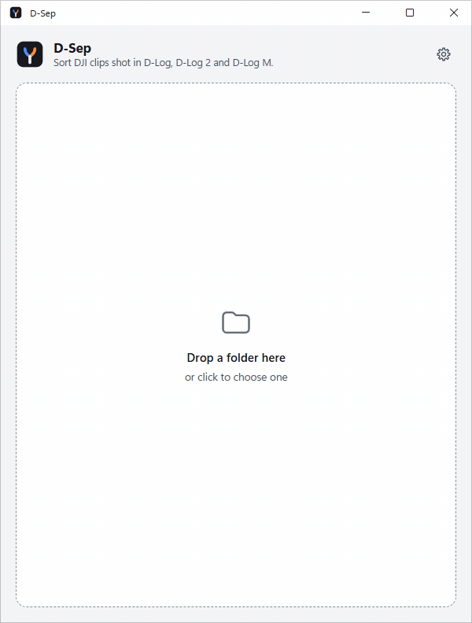

<div align="center">

# D-Sep

**Easily separate clips recorded in DJI D-Log, D-Log 2 and D-Log M profiles from the rest of your footage**

Pick a folder, press Sort, done.

[](LICENSE)
[](https://github.com/ztcs-software/d-sep/releases)




</div>

---

## 🔭 What it does

Some DJI devices, including DJI Osmo Pocket 4P, label every clip as Rec.709, even when it was shot in a log profile, so Explorer and most video editors
can't tell D-Log footage from normal footage. D-Sep reads the profile the camera really used and
separates the log clips: into `D-Log`, `D-Log 2` and `D-Log M` folders, by adding a prefix to their
names (`DL_`, `DL2_`, `DLM_`, or your own), or both.

| Separate by | `DJI_0001.MP4` shot in D-Log becomes |
| --- | --- |
| Folders | `D-Log\DJI_0001.MP4` |
| Names | `DL_DJI_0001.MP4` |
| Folders + Names | `D-Log\DL_DJI_0001.MP4` |

Clips can be copied or moved, in place or into another folder, and their `.LRF` and `.SRT` files go
with them. Everything else stays where it is, nothing is ever overwritten, and a move can be undone.

---

## 💾 Download

**👉 Get D-Sep from the [latest release](https://github.com/ztcs-software/d-sep/releases/latest).** There are two versions:

- **Installer**: `D-Sep_<version>_x64-setup.exe` installs D-Sep for your account and adds it to the
  Start menu.
- **Portable**: `D-Sep_<version>_x64-portable.exe` is the whole app in one file, with nothing to install.
  Keep it with your clips and it offers to sort the folder it's in.

Both run on 64-bit Windows 10 and 11. They aren't code-signed yet, so the first time you open one,
Windows may say it protected your PC: click **More info**, then **Run anyway**.

---

## 🛠️ Build from source

You need Windows with [Node.js](https://nodejs.org) 22.12+, [Rust](https://rustup.rs) 1.88+ and the
[Tauri prerequisites](https://tauri.app/start/prerequisites/) (Microsoft C++ Build Tools).

```bash
git clone https://github.com/ztcs-software/d-sep.git
cd d-sep
npm install
npm run exe      # portable app → src-tauri/target/release/D-Sep.exe
npm run setup    # installer    → src-tauri/target/release/bundle/nsis/
```

`npm run app` opens a live-reloading window for development.

---

## 🧩 Built with

| Part | Technology |
| --- | --- |
| App shell | [Tauri 2](https://tauri.app) |
| Backend | Rust, with the Win32 API for copying and moving files |
| UI | [Svelte 5](https://svelte.dev) + TypeScript, built with [Vite](https://vite.dev) |
| Tests | Vitest and `cargo test` |

---

## 📜 License

[MIT](LICENSE) © ZTCS
